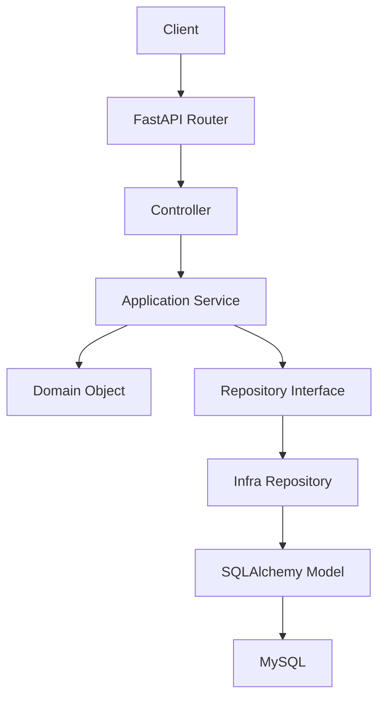
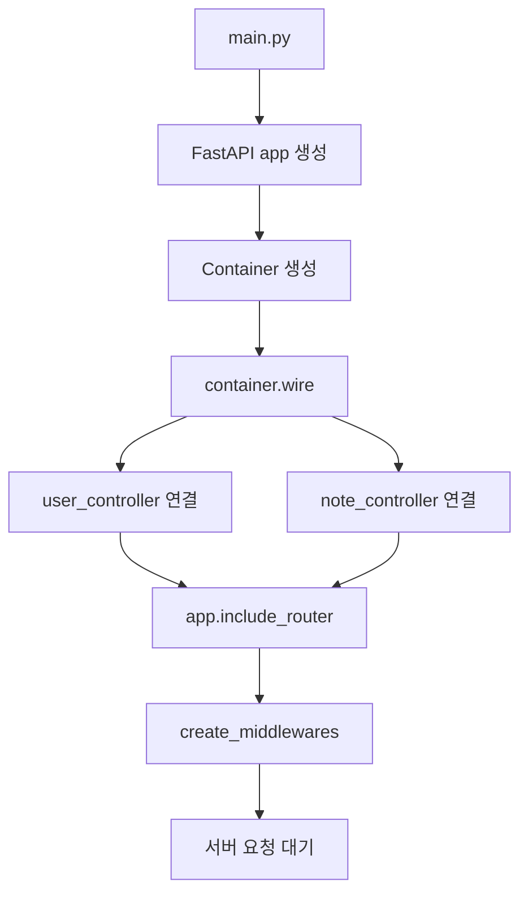
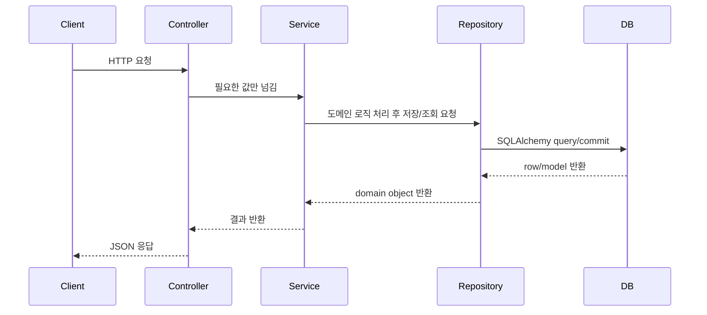

# 전체 흐름

이 프로젝트는 FastAPI로 만든 TIL(Today I Learned) API 서버입니다. GitHub 저장소 `dextto/fastapi-ca`의 구조를 참고해서 사용자, 로그인, TIL 노트, Celery 메일, 로깅을 계층형 코드 구조로 구현했습니다.

문서 설명은 기능별로 쪼갰습니다. 각 기능 문서 안에는 코드 구현 흐름 그림, 실제 호출 순서, 핵심 코드, 왜 그렇게 구현했는지까지 같이 적었습니다.

## 전체 계층 구조



## 앱이 켜질 때 코드 흐름



## 요청 하나가 처리되는 기본 흐름



## 기능별 문서 위치

- `01_환경설정.md`: `.env`가 어떤 코드로 흘러가는지 설명
- `02_회원가입_메일_Celery.md`: 회원가입 저장 흐름과 Celery 메일 큐 흐름 설명
- `03_로그인_JWT.md`: 로그인, 비밀번호 검증, JWT 발급/검증 설명
- `04_TIL_앱_기능.md`: TIL 작성/조회/수정/삭제/태그 조회 설명
- `05_로깅.md`: 요청 로깅, user context, logger filter 설명
- `06_DB_마이그레이션.md`: DB 모델과 Alembic 흐름 설명
- `07_curl_예시.md`: bash 기준 curl 실행 예시
- `08_코드_흐름_중심_설명.md`: 전체 코드 흐름 빠른 색인

## 설계 기준

컨트롤러는 HTTP 요청/응답만 다룹니다. 서비스는 비즈니스 판단을 담당합니다. 저장소는 DB 접근을 담당합니다. 이 경계를 나눈 이유는 기능이 늘어나도 코드가 한 파일에 섞이지 않게 하기 위해서입니다.

예를 들어 회원가입은 다음 책임으로 나뉩니다.

```text
user_controller.py  -> 요청 body 받기
user_service.py     -> 중복 검사, 비밀번호 암호화, 메일 task 요청
user_repo.py        -> DB 저장
common/messaging.py -> Celery task 등록
email_service.py    -> SMTP 발송
```