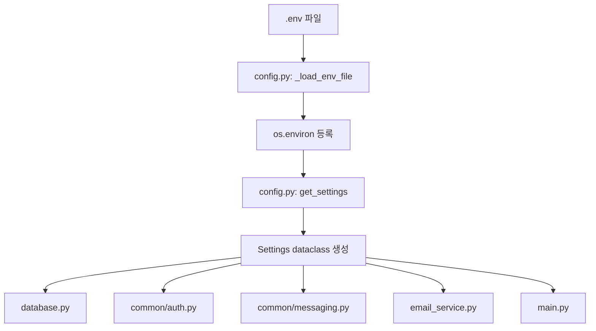

# 환경설정

이 프로젝트는 DB 주소, JWT secret, Gmail SMTP, Celery Redis 주소를 코드에 직접 쓰지 않고 `.env`에서 읽습니다. 설정을 한 곳에서 관리해야 개발 환경과 실행 환경이 달라도 코드 수정 없이 값을 바꿀 수 있습니다.

## 구현된 파일

```text
.env
config.py
database.py
common/auth.py
common/messaging.py
user/application/email_service.py
main.py
```

## 코드 구현 흐름 그림



## 실제 호출 흐름

```text
서버 import
-> database.py import
-> get_settings()
-> .env 읽기
-> DATABASE_* 값으로 SQLALCHEMY_DATABASE_URL 생성
```

```text
로그인/JWT 발급
-> common/auth.py
-> get_settings().jwt_secret
-> JWT 서명 생성 또는 검증
```

```text
메일 발송
-> email_service.py
-> get_settings().email_sender/email_password/email_host/email_port
-> Gmail SMTP 연결
```

```text
Celery 시작
-> common/messaging.py
-> get_settings().celery_broker_url/celery_backend_url
-> Celery app 생성
```

## 핵심 코드

`config.py`

```python
def get_settings() -> Settings:
    _load_env_file()

    return Settings(
        database_username=_get_required_env("DATABASE_USERNAME"),
        jwt_secret=_get_required_env("JWT_SECRET"),
        email_sender=_get_required_env("EMAIL_SENDER"),
        celery_broker_url=_get_required_env("CELERY_BROKER_URL"),
    )
```

## 왜 utf-8-sig로 읽는가

PowerShell로 `.env`를 저장하면 파일 앞에 BOM이 붙을 수 있습니다. BOM이 붙으면 첫 번째 키가 `DATABASE_USERNAME`이 아니라 이상한 문자 포함 키로 읽힐 수 있습니다. 그래서 `.env`는 `utf-8-sig`로 읽게 했습니다.

```python
env_path.read_text(encoding="utf-8-sig")
```

## 필요한 환경변수

```env
DATABASE_USERNAME=
DATABASE_PASSWORD=
DATABASE_HOST=
DATABASE_PORT=
DATABASE_NAME=
JWT_SECRET=
APP_HOST=
APP_PORT=
EMAIL_SENDER=
EMAIL_HOST=
EMAIL_PORT=
EMAIL_PASSWORD=
CELERY_BROKER_URL=
CELERY_BACKEND_URL=
```

## 주의점

실제 `.env`에는 비밀번호와 Gmail 앱 비밀번호가 들어갑니다. 그래서 README나 설명 문서에는 실제 비밀값을 적지 않습니다. `EMAIL_PASSWORD`는 Gmail 앱 비밀번호이며, 일반 로그인 비밀번호가 아닙니다.