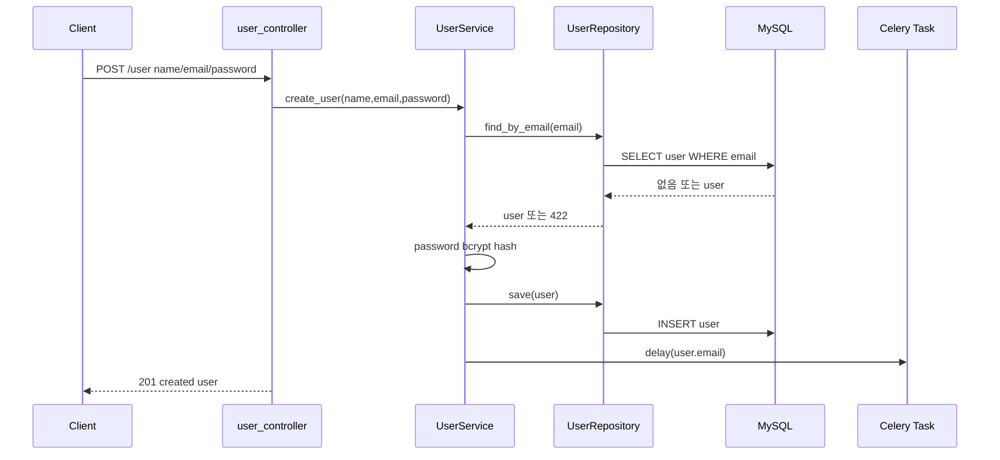
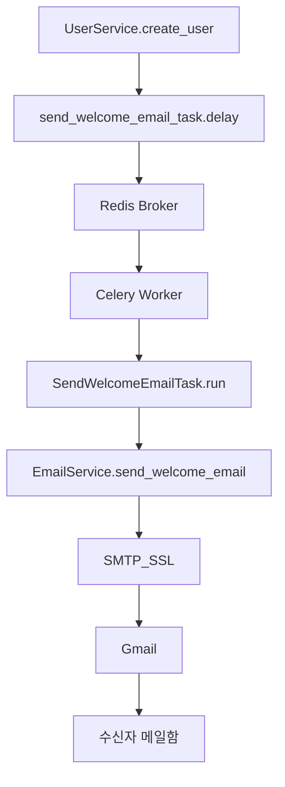

# 회원가입, 메일, Celery

이 문서는 회원가입 API가 어떻게 유저를 저장하고, 회원가입 환영 메일을 Celery로 넘기는지 코드 흐름 기준으로 설명합니다.

## 관련 파일

```text
user/interface/controllers/user_controller.py
user/application/user_service.py
user/infra/repository/user_repo.py
user/domain/user.py
utils/crypto.py
common/messaging.py
user/application/send_welcome_email_task.py
user/application/email_service.py
containers.py
```

## 1. 회원가입 요청 흐름 그림



## 2. 실제 코드 호출 순서

```text
POST /user
-> user_controller.create_user()
-> user_service.create_user()
-> user_repo.find_by_email()
-> Crypto.encrypt()
-> user_repo.save()
-> send_welcome_email_task.delay()
-> HTTP 201 응답
```

## 3. Controller 코드 역할

`user_controller.py`

```python
@router.post("", status_code=201)
def create_user(
    user: CreateUserBody,
    user_service: UserService = Depends(Provide[Container.user_service]),
):
    created_user = user_service.create_user(
        name=user.name,
        email=user.email,
        password=user.password,
    )

    return created_user
```

Controller는 HTTP body를 받고 Service에 넘깁니다. 중복 검사, 비밀번호 암호화, 메일 큐 등록은 Controller가 하지 않습니다. Controller가 모든 일을 하면 API가 늘어날수록 파일이 커지고 테스트하기 어려워지기 때문입니다.

## 4. Service 코드 역할

`user_service.py`

```python
_user = None
try:
    _user = self.user_repo.find_by_email(email)
except HTTPException as e:
    if e.status_code != 422:
        raise e

if _user:
    raise HTTPException(status_code=422)
```

먼저 이메일 중복을 확인합니다. 저장소는 유저가 없을 때 `422`를 던지므로, 회원가입에서는 그 `422`를 “가입 가능” 신호로 해석합니다. 다른 에러면 그대로 올립니다.

```python
user = User(
    id=self.ulid.generate(),
    name=name,
    email=email,
    password=self.crypto.encrypt(password),
    created_at=now,
    updated_at=now,
    memo=memo,
)
```

비밀번호는 평문으로 저장하지 않고 bcrypt hash로 저장합니다.

```python
self.user_repo.save(user)
self.send_welcome_email_task.delay(user.email)
```

DB 저장이 성공한 뒤 메일 태스크를 큐에 넣습니다. 저장 실패한 유저에게 메일이 나가면 안 되기 때문에 이 순서가 중요합니다.

## 5. Celery 메일 흐름 그림



## 6. Celery 등록 코드

`common/messaging.py`

```python
celery = Celery(
    "til-app",
    broker=settings.celery_broker_url,
    backend=settings.celery_backend_url,
    broker_connection_retry_on_startup=True,
)

send_welcome_email_task = celery.register_task(SendWelcomeEmailTask())
```

FastAPI 프로세스와 Celery worker가 같은 task 이름을 알아야 합니다. 그래서 task 객체를 `common/messaging.py`에서 등록하고, `containers.py`가 이 객체를 `UserService`에 주입합니다.

## 7. worker가 실행하는 코드

`send_welcome_email_task.py`

```python
class SendWelcomeEmailTask(Task):
    name = "send_welcome_email_task"

    def run(self, receiver_email: str):
        EmailService().send_welcome_email(receiver_email)
```

worker는 Redis에서 `send_welcome_email_task` 작업을 받으면 `run()`을 실행합니다. 이 안에서 `EmailService`를 호출합니다.

## 8. SMTP 발송 코드

`email_service.py`

```python
with smtplib.SMTP_SSL(settings.email_host, settings.email_port) as server:
    server.login(settings.email_sender, settings.email_password)
    server.send_message(message)
```

Gmail SMTP는 `EMAIL_SENDER`, `EMAIL_PASSWORD`, `EMAIL_HOST`, `EMAIL_PORT` 환경변수를 사용합니다.

## 9. 실행할 것

Redis:

```bash
docker start til-redis
```

Celery worker:

```bash
.venv/Scripts/celery.exe -A common.messaging.celery worker --loglevel=info --pool=solo
```

FastAPI:

```bash
.venv/Scripts/uvicorn.exe main:app --reload
```

## 10. 성공 확인

worker 로그에 아래처럼 나오면 메일 task가 정상 처리된 것입니다.

```text
Task send_welcome_email_task[...] received
Task send_welcome_email_task[...] succeeded
```

## 11. 실패할 수 있는 지점

- Redis가 꺼져 있으면 `.delay()`에서 브로커 연결 실패가 납니다.
- Celery worker가 꺼져 있으면 Redis에 작업은 쌓이지만 메일은 발송되지 않습니다.
- Gmail 앱 비밀번호가 틀리면 worker에서 SMTP 인증 실패가 납니다.
- 이미 가입된 이메일이면 회원가입이 `422`로 막히므로 메일 task도 등록되지 않습니다.