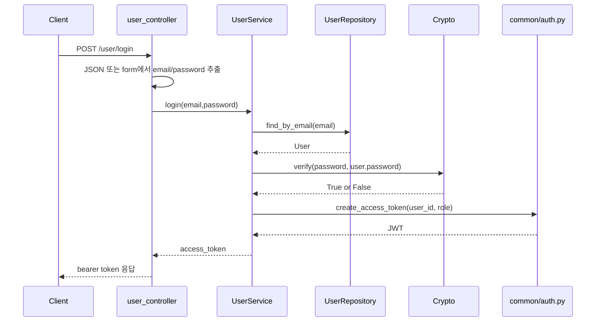
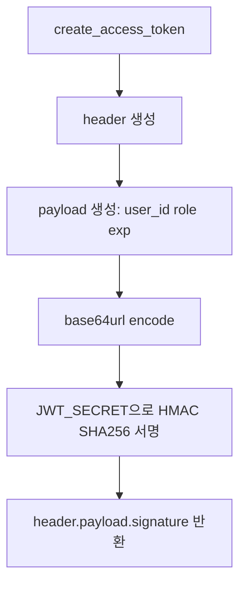
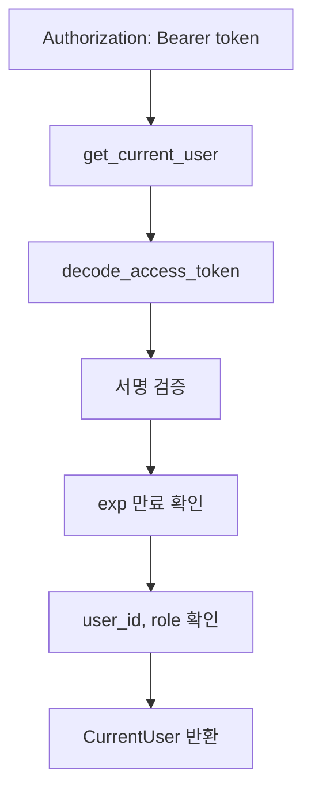

# 로그인과 JWT

이 문서는 로그인 API가 이메일/비밀번호를 검증하고 JWT access token을 만드는 코드 흐름을 설명합니다.

## 관련 파일

```text
user/interface/controllers/user_controller.py
user/application/user_service.py
user/infra/repository/user_repo.py
utils/crypto.py
common/auth.py
config.py
```

## 1. 로그인 전체 흐름 그림



## 2. 실제 코드 호출 순서

```text
POST /user/login
-> user_controller.login()
-> request content-type 확인
-> email/password 추출
-> user_service.login()
-> user_repo.find_by_email()
-> crypto.verify()
-> create_access_token()
-> { access_token, token_type }
```

## 3. Controller가 하는 일

`user_controller.py`

```python
if "application/json" in content_type:
    body = await request.json()
    email = body.get("email") or body.get("username")
    password = body.get("password")
else:
    form = parse_qs((await request.body()).decode("utf-8"))
    email = form.get("email", form.get("username", [None]))[0]
    password = form.get("password", [None])[0]
```

원본 GitHub 코드는 `OAuth2PasswordRequestForm`을 사용합니다. 로컬에서는 `python-multipart` 미설치 상태에서도 앱이 죽지 않게 JSON과 form body를 직접 파싱하도록 했습니다.

## 4. Service가 하는 일

`user_service.py`

```python
user = self.user_repo.find_by_email(email)

if not self.crypto.verify(password, user.password):
    raise HTTPException(status_code=status.HTTP_401_UNAUTHORIZED)
```

DB에 저장된 비밀번호는 bcrypt hash입니다. 로그인 때는 입력한 평문 비밀번호를 hash와 비교합니다.

```python
access_token = create_access_token(
    payload={"user_id": user.id},
    role=Role.USER,
)
```

비밀번호가 맞으면 JWT를 발급합니다. payload에는 `user_id`가 들어가고 role은 `USER`로 들어갑니다.

## 5. JWT 생성 흐름



## 6. 인증 API에서 JWT 검증 흐름



`common/auth.py`

```python
def get_current_user(token: Annotated[str, Depends(oauth2_scheme)]):
    payload = decode_access_token(token)

    user_id = payload.get("user_id")
    role = payload.get("role")
    if not user_id or role != Role.USER:
        raise HTTPException(status_code=status.HTTP_403_FORBIDDEN)

    return CurrentUser(id=user_id, role=Role(role))
```

## 7. 실패 케이스

- body에 email/password가 없으면 `400`
- 이메일이 DB에 없으면 repository에서 `422`
- 비밀번호가 틀리면 `401`
- 토큰이 잘못되었거나 만료되면 `401`
- role이 USER가 아니면 `403`