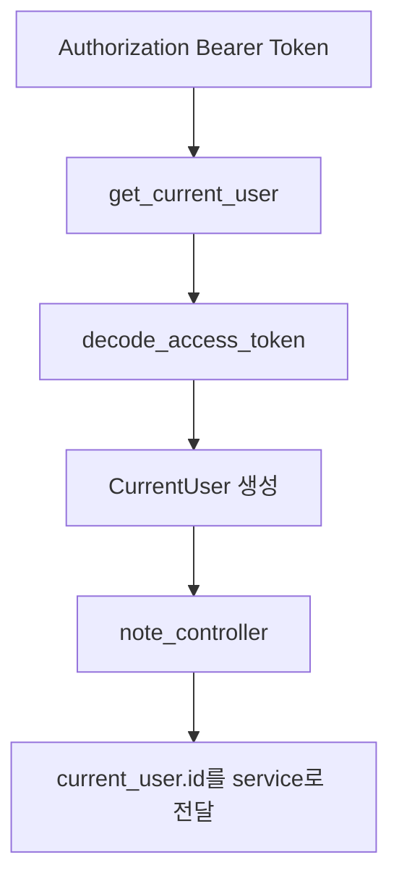
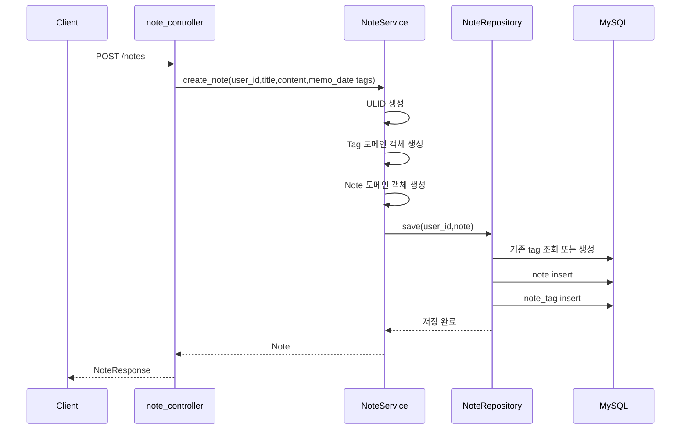
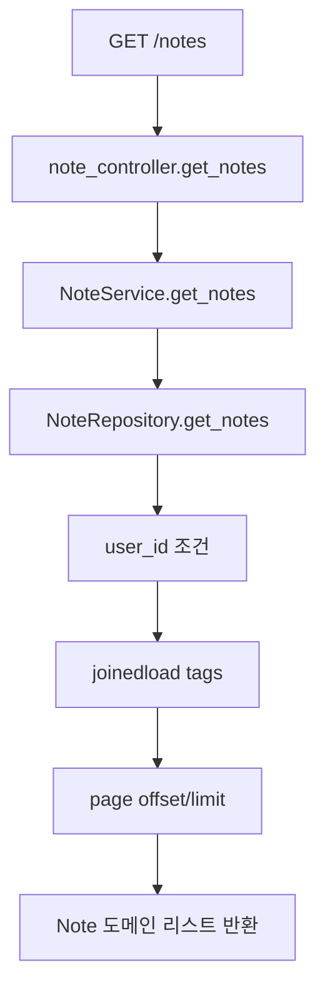
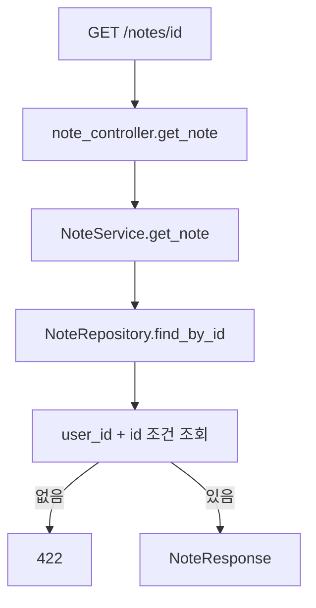
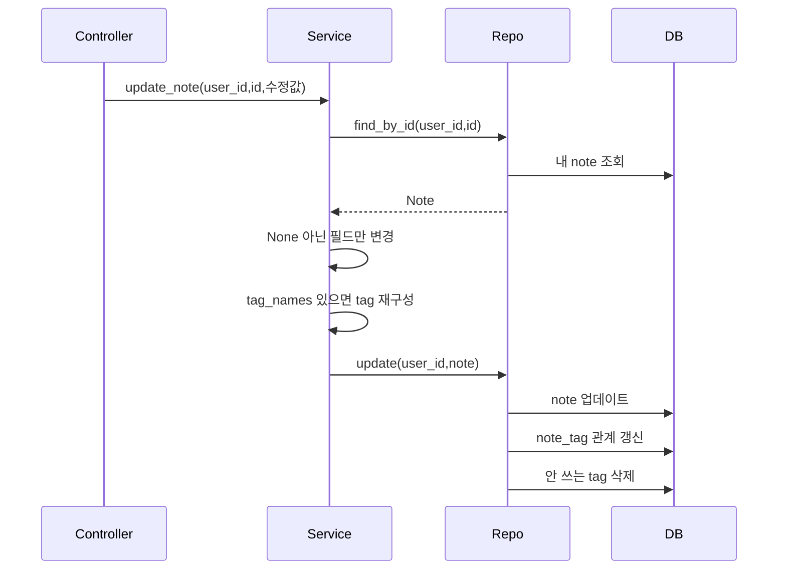
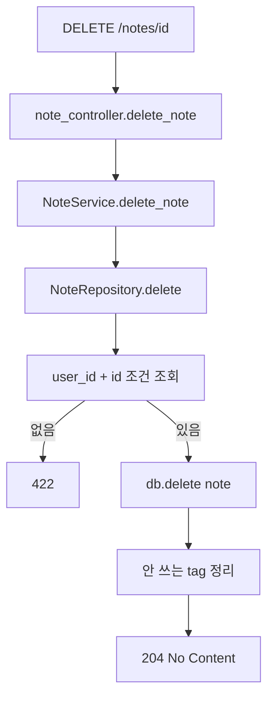
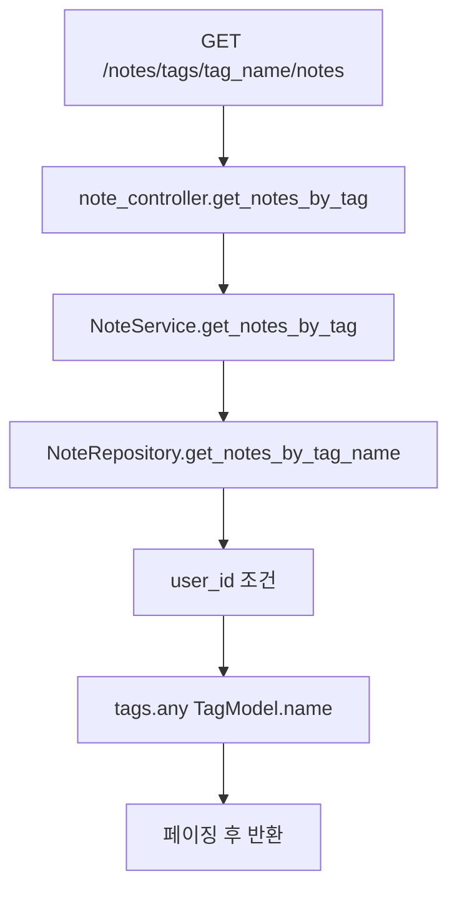
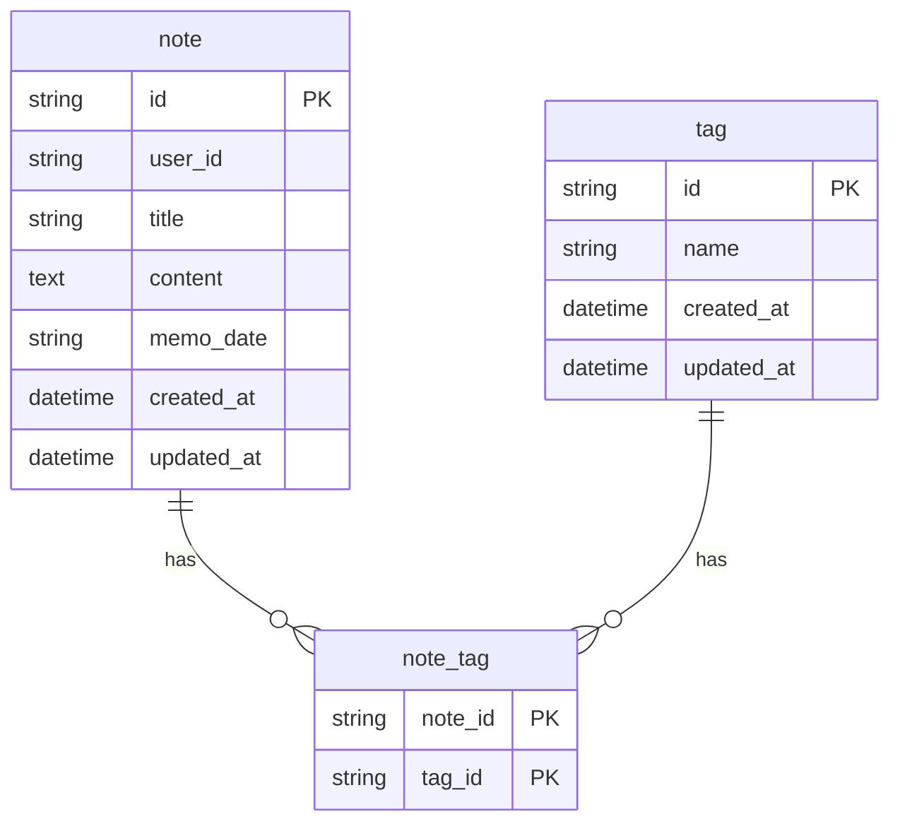

# TIL 앱 기능

이 문서는 TIL 노트 기능을 코드 흐름 중심으로 설명합니다. GitHub 저장소의 `note` 모듈을 참고해서 `note` 패키지를 만들었습니다.

## 관련 파일

```text
note/interface/controllers/note_controller.py
note/application/note_service.py
note/domain/note.py
note/domain/repository/note_repo.py
note/infra/repository/note_repo.py
note/infra/db_models/note.py
common/auth.py
```

## 1. TIL API 목록

```text
POST   /notes
GET    /notes
GET    /notes/{id}
PUT    /notes/{id}
DELETE /notes/{id}
GET    /notes/tags/{tag_name}/notes
```

모든 TIL API는 로그인한 유저 기준으로 동작합니다.

## 2. 인증부터 TIL Controller까지 흐름



Controller에서 `current_user.id`를 계속 넘기는 이유는 남의 TIL을 조회, 수정, 삭제하지 못하게 하기 위해서입니다.

## 3. TIL 작성 코드 흐름



### 핵심 코드

`note_service.py`

```python
note = Note(
    id=self.ulid.generate(),
    user_id=user_id,
    title=title,
    content=content,
    memo_date=memo_date,
    tags=tags,
    created_at=now,
    updated_at=now,
)

self.note_repo.save(user_id, note)
```

Service가 ID와 시간을 만듭니다. Repository는 DB 저장만 맡습니다.

## 4. TIL 목록 조회 코드 흐름



### 핵심 코드

`note/infra/repository/note_repo.py`

```python
query = (
    db.query(NoteModel)
    .options(joinedload(NoteModel.tags))
    .filter(NoteModel.user_id == user_id)
    .order_by(NoteModel.memo_date.desc(), NoteModel.created_at.desc())
)
```

반드시 `user_id` 조건이 들어갑니다. 이 조건이 없으면 다른 사람의 TIL까지 볼 수 있습니다.

## 5. TIL 단건 조회 코드 흐름



단건 조회도 `id`만 보지 않고 `user_id`를 같이 봅니다.

## 6. TIL 수정 코드 흐름



### 핵심 코드

`note_service.py`

```python
if title:
    note.title = title
if content:
    note.content = content
if memo_date:
    note.memo_date = memo_date
if tag_names is not None:
    note.tags = self._create_tags(tag_names, datetime.now())
```

수정 요청에 없는 값은 건드리지 않습니다. 태그는 `None`이면 그대로 두고, 빈 리스트 `[]`면 태그를 전부 제거합니다.

## 7. TIL 삭제 코드 흐름



삭제 후 어떤 노트에도 연결되지 않은 태그는 삭제합니다.

```python
unused_tags = db.query(TagModel).filter(~TagModel.notes.any()).all()
for tag in unused_tags:
    db.delete(tag)
```

## 8. 태그 조회 코드 흐름



태그 조회도 내 노트 안에서만 검색합니다.

## 9. DB 테이블 관계



## 10. 구현 이유 정리

- `note_controller`: HTTP 요청/응답, 인증 유저 추출
- `note_service`: ID 생성, 시간 생성, 필드 변경 규칙 처리
- `note_repo`: SQLAlchemy query와 commit 담당
- `note/domain/note.py`: DB와 분리된 순수 데이터 구조
- `note/infra/db_models/note.py`: 실제 테이블 구조