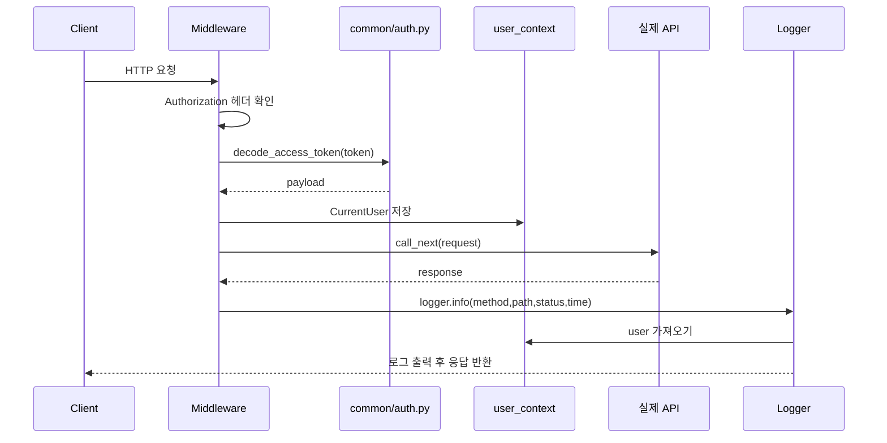
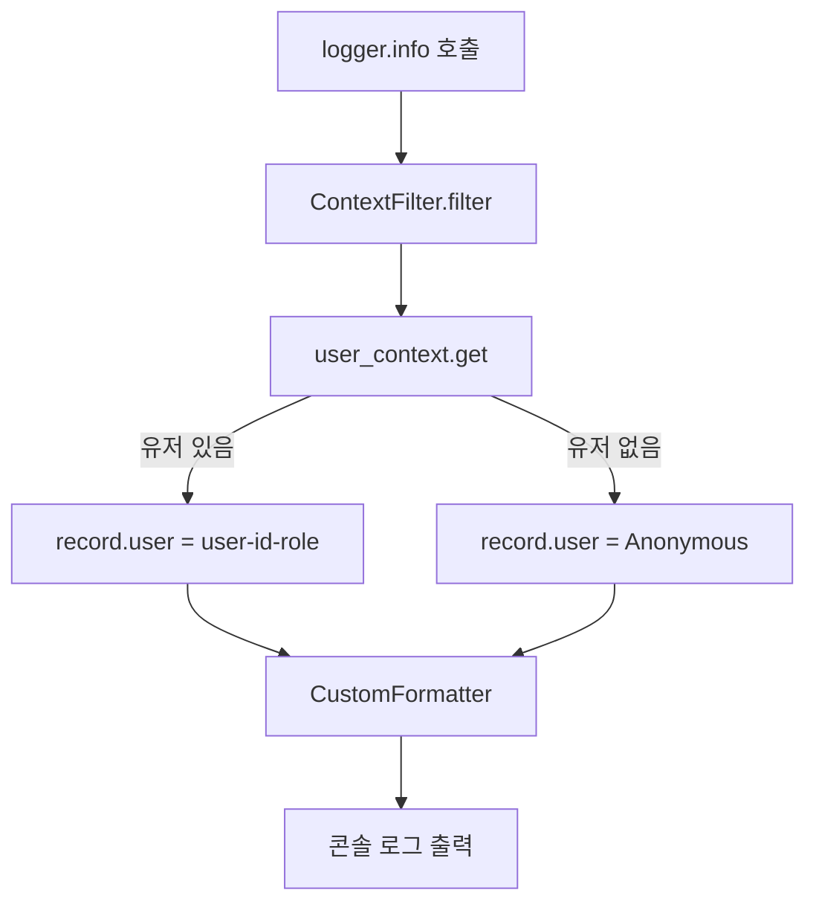

# 로깅

이 문서는 요청 로깅이 어떤 코드 흐름으로 동작하는지 설명합니다. GitHub 저장소의 `common/logger.py`, `middlewares.py`, `context_vars.py` 구조를 참고했습니다.

## 관련 파일

```text
main.py
middlewares.py
context_vars.py
common/logger.py
common/auth.py
```

## 1. 로깅 미들웨어 등록 흐름

```mermaid
flowchart TD
    A[main.py] --> B[create_middlewares import]
    B --> C[create_middlewares app 호출]
    C --> D[@app.middleware http 등록]
    D --> E[모든 HTTP 요청 전에 middleware 실행]
```

`main.py`

```python
create_middlewares(app)
```

이 한 줄 때문에 모든 요청은 controller에 도달하기 전에 `logging_middleware`를 지나갑니다.

## 2. 요청 하나의 로깅 흐름



## 3. user context가 필요한 이유

요청 처리 중 여러 함수가 실행되어도 “이 요청의 유저가 누구인지” 로그에 붙이고 싶습니다. 함수마다 user를 인자로 넘기면 코드가 지저분해집니다. 그래서 `contextvars.ContextVar`를 사용합니다.

`context_vars.py`

```python
user_context: ContextVar[CurrentUser | None] = ContextVar(
    "current_user",
    default=None,
)
```

이 값은 요청 단위로 분리됩니다. 한 요청의 유저가 다른 요청 로그에 섞이지 않게 마지막에 reset합니다.

## 4. middleware 코드 흐름

`middlewares.py`

```python
token = user_context.set(None)
current_user = _get_user_from_authorization(
    request.headers.get("Authorization")
)
if current_user:
    user_context.set(current_user)
```

요청이 들어오면 먼저 context를 비웁니다. Authorization 헤더가 있으면 JWT를 읽어서 CurrentUser를 만듭니다.

```python
response = await call_next(request)
elapsed_ms = (perf_counter() - started_at) * 1000
logger.info(
    "%s %s -> %s %.2fms",
    request.method,
    request.url.path,
    response.status_code,
    elapsed_ms,
)
```

실제 API 실행 후 status code와 걸린 시간을 로그에 남깁니다.

```python
finally:
    user_context.reset(token)
```

마지막에는 context를 원래 상태로 돌립니다. 이게 없으면 다음 요청에 이전 유저가 남을 수 있습니다.

## 5. logger filter 코드 흐름



`common/logger.py`

```python
class ContextFilter(logging.Filter):
    def filter(self, record: logging.LogRecord) -> bool:
        user = user_context.get()
        record.user = str(user) if user else "Anonymous"
        return True
```

## 6. 실제 로그 예시

익명 요청:

```text
2026-05-19 20:20:54,318 til-app INFO: user: Anonymous: GET / -> 200 2.74ms
```

토큰 포함 요청:

```text
2026-05-19 20:21:07,401 til-app INFO: user: user-1(USER): GET / -> 200 4.14ms
```

## 7. 원본 대비 보강한 점

GitHub 원본은 request URL 중심으로 로그를 찍습니다. 로컬 구현은 디버깅 편의를 위해 아래 값을 더 넣었습니다.

- HTTP method
- path
- status code
- elapsed time
- user context

## 8. 실패/주의점

- Authorization 헤더가 없으면 `Anonymous`로 찍힙니다.
- 토큰이 잘못되어도 로깅 미들웨어에서는 요청을 막지 않고 `Anonymous`로 둡니다.
- 실제 보호 API는 `get_current_user` dependency가 따로 막습니다.