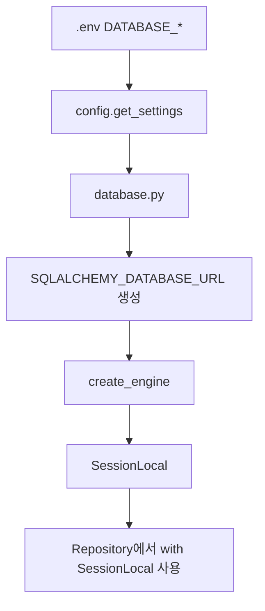
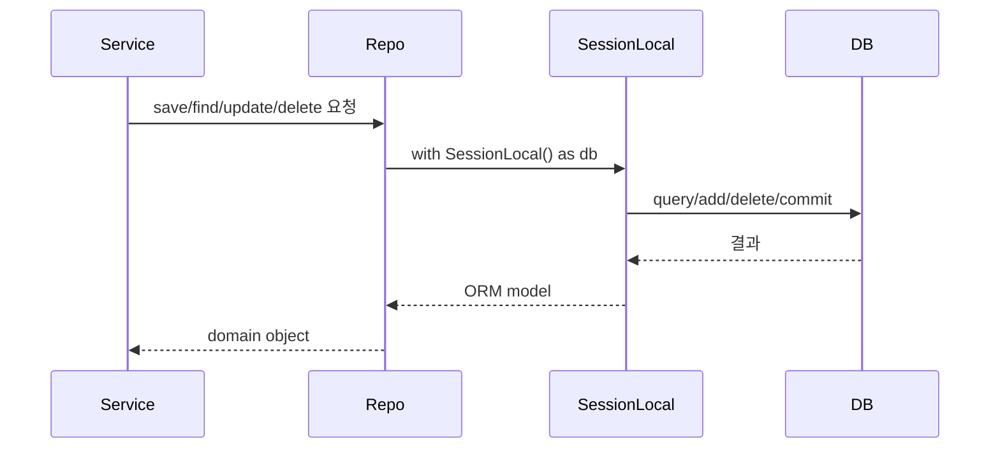
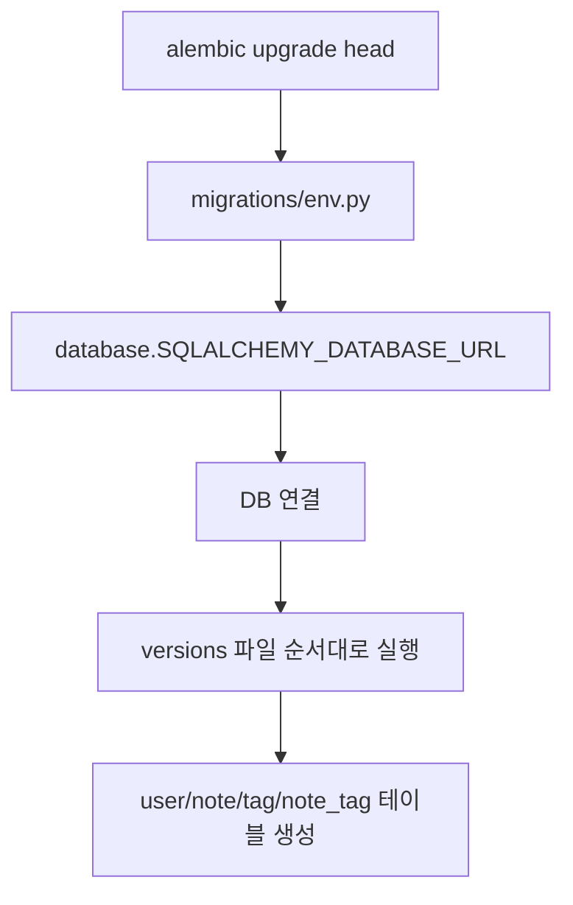
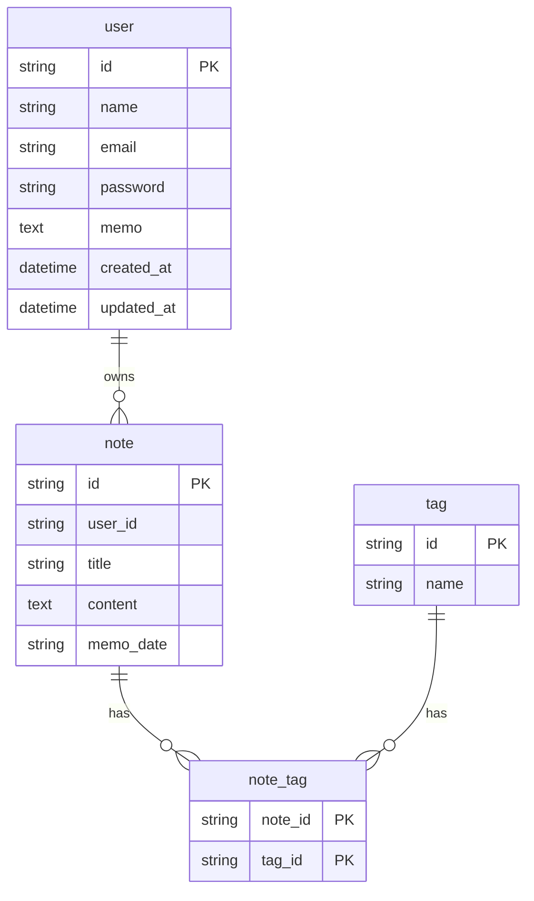

# DB와 마이그레이션

이 문서는 DB 모델과 Alembic 마이그레이션이 어떤 흐름으로 동작하는지 설명합니다.

## 관련 파일

```text
database.py
database_model.py
migrations/env.py
migrations/versions/5081832f5d2c_add_user_table.py
migrations/versions/8b2f6c1d4e90_add_note_tables.py
user/infra/db_models/user.py
note/infra/db_models/note.py
```

## 1. DB 연결 코드 흐름



`database.py`

```python
SQLALCHEMY_DATABASE_URL = (
    "mysql+pymysql://"
    f"{settings.database_username}:{settings.database_password}"
    f"@{settings.database_host}:{settings.database_port}/{settings.database_name}"
)
```

DB 접속 정보는 전부 `.env`에서 옵니다.

## 2. Repository에서 DB를 쓰는 흐름



## 3. Alembic 마이그레이션 흐름



## 4. 모델 등록

`database_model.py`

```python
import note.infra.db_models.note
import user.infra.db_models.user
```

Alembic이 SQLAlchemy metadata를 알 수 있게 모델을 import합니다.

## 5. 테이블 관계 그림



## 6. 실행 명령

```bash
.venv/Scripts/alembic.exe upgrade head
```

## 7. 주의점

- 모델을 만들고 `database_model.py`에 import하지 않으면 Alembic metadata에 안 잡힐 수 있습니다.
- DB 접속 정보가 틀리면 `alembic upgrade head`에서 실패합니다.
- 현재 TIL 테이블 마이그레이션 head는 `8b2f6c1d4e90_add_note_tables.py`입니다.