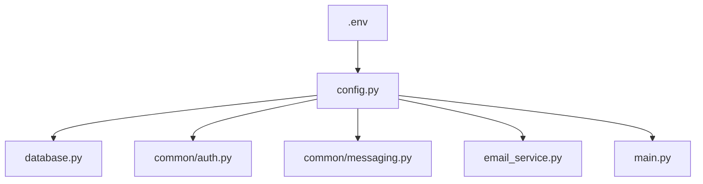
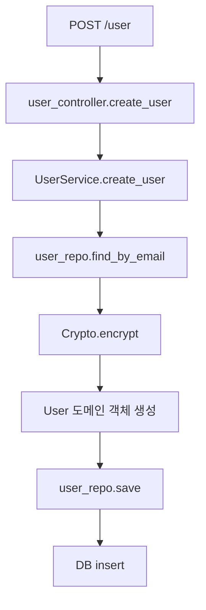
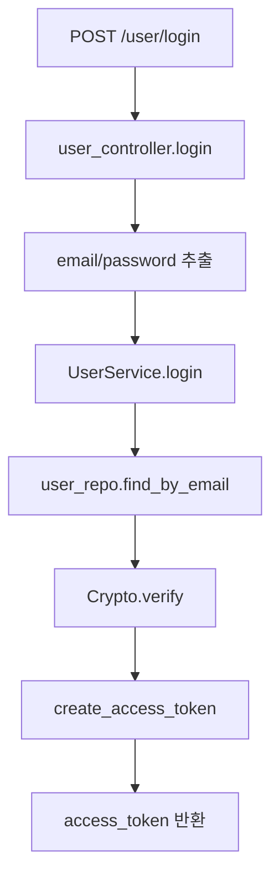
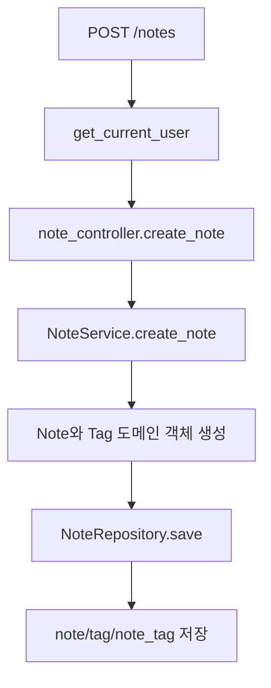
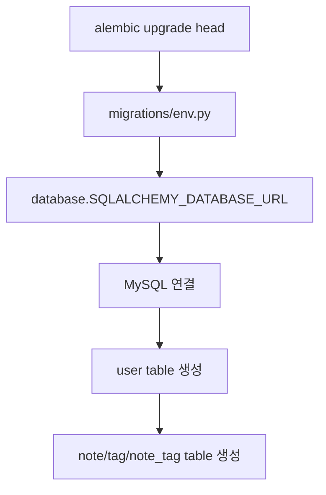
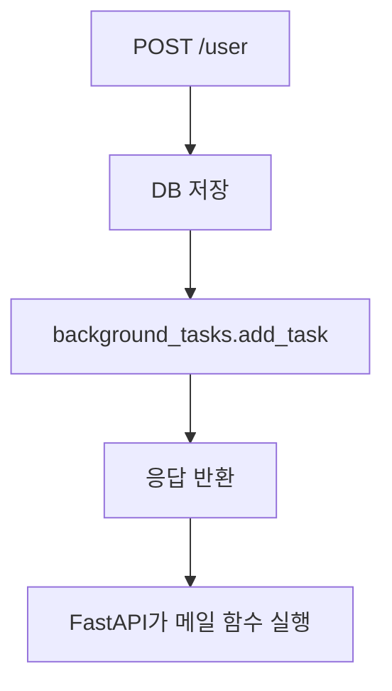
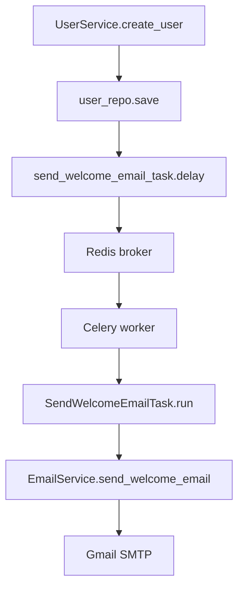
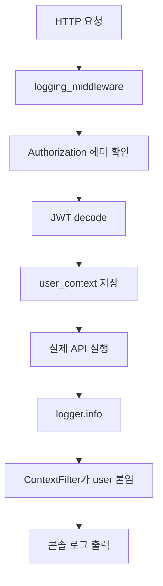
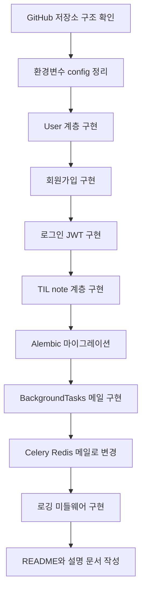

# 구현 흐름

이 문서는 기능 설명이 아니라, 이 프로젝트를 어떤 순서로 구현했는지 설명합니다. 핵심은 “왜 이 코드를 먼저 만들고, 그 다음에 어떤 코드가 필요해졌는가”입니다.

## 1. 기준 구조를 먼저 잡았다

처음에는 GitHub 저장소 `dextto/fastapi-ca`의 구조를 참고했습니다. 그 저장소는 기능을 한 파일에 몰아넣지 않고 아래처럼 나눕니다.

```text
interface/controllers  -> HTTP 요청/응답
application            -> 비즈니스 로직
domain                 -> 도메인 객체, repository interface
infra                  -> DB model, repository 구현
common                 -> 인증, 메시징, 로깅 같은 공통 기능
```

그래서 로컬 프로젝트도 같은 방향으로 잡았습니다.

```text
user/
note/
common/
utils/
migrations/
```

이 구조를 먼저 잡은 이유는 회원가입, 로그인, TIL, 메일, 로깅이 전부 섞이면 이후 수정이 힘들어지기 때문입니다.

## 2. 환경변수 설정을 먼저 정리했다

메일, DB, JWT, Celery는 전부 환경마다 값이 달라집니다. 그래서 하드코딩된 값을 없애고 `.env -> config.py -> 각 모듈` 흐름을 먼저 만들었습니다.



구현한 파일:

```text
config.py
database.py
common/auth.py
common/messaging.py
user/application/email_service.py
main.py
```

구현 이유:

```text
DB 연결을 만들려면 DB 환경변수가 필요하다.
JWT를 만들려면 JWT_SECRET이 필요하다.
메일을 보내려면 EMAIL_* 값이 필요하다.
Celery를 쓰려면 CELERY_* 값이 필요하다.
```

그래서 환경변수 로딩을 먼저 만들었습니다.

## 3. 사용자 저장 흐름을 만들었다

그 다음에는 회원가입을 만들었습니다. 회원가입이 있어야 로그인도 가능하고, TIL도 유저 소유로 만들 수 있습니다.

구현 순서:

```text
user/domain/user.py
-> user/domain/repository/user_repo.py
-> user/infra/db_models/user.py
-> user/infra/repository/user_repo.py
-> user/application/user_service.py
-> user/interface/controllers/user_controller.py
```

코드 흐름:



왜 이 순서인가:

```text
1. DB에 저장할 데이터 모양이 필요해서 User 도메인을 만들었다.
2. Service가 DB 구현체에 직접 의존하지 않게 repository interface를 만들었다.
3. 실제 DB 저장이 필요해서 SQLAlchemy model과 repository 구현체를 만들었다.
4. 중복 검사, 비밀번호 암호화 같은 비즈니스 로직은 service에 넣었다.
5. 마지막으로 HTTP endpoint를 controller에 붙였다.
```

## 4. 로그인과 JWT를 붙였다

회원가입으로 유저가 생기면 로그인할 수 있어야 합니다. 로그인은 단순히 유저를 찾는 게 아니라 비밀번호 검증과 토큰 발급이 필요합니다.

구현 순서:

```text
utils/crypto.py 확인
-> common/auth.py 작성
-> UserService.login 추가
-> user_controller.py에 POST /user/login 추가
```

코드 흐름:



왜 이 순서인가:

```text
1. 저장된 비밀번호가 bcrypt hash라서 Crypto.verify가 필요했다.
2. 로그인 성공 후 API 인증에 쓸 토큰이 필요해서 common/auth.py를 만들었다.
3. Service에서 유저 조회와 비밀번호 검증을 처리했다.
4. Controller는 JSON/form 요청을 받아 Service로 넘기게 했다.
```

## 5. 인증 의존성을 만든 뒤 TIL 기능을 붙였다

TIL은 개인 데이터입니다. 그래서 TIL 기능을 만들기 전에 “현재 로그인한 유저가 누구인지”를 알 수 있어야 했습니다.

먼저 만든 것:

```text
common/auth.py:get_current_user
```

그 다음 만든 것:

```text
note/domain/note.py
note/domain/repository/note_repo.py
note/infra/db_models/note.py
note/infra/repository/note_repo.py
note/application/note_service.py
note/interface/controllers/note_controller.py
```

TIL 작성 흐름:



왜 이 순서인가:

```text
1. TIL은 반드시 user_id를 가져야 하므로 인증 흐름이 먼저 필요했다.
2. 노트와 태그의 데이터 모양을 note/domain에 만들었다.
3. 노트와 태그는 다대다 관계라 note_tag 테이블이 필요했다.
4. DB 저장 방식은 infra/repository에 넣었다.
5. 생성, 조회, 수정, 삭제 규칙은 NoteService에 넣었다.
6. 마지막으로 /notes API를 controller에 열었다.
```

중요한 구현 판단:

```python
.filter(NoteModel.user_id == user_id)
```

모든 조회, 수정, 삭제에 `user_id` 조건을 넣었습니다. 이유는 노트 ID를 알아도 남의 TIL을 건드리지 못하게 하기 위해서입니다.

## 6. DB 마이그레이션을 추가했다

코드에 SQLAlchemy 모델만 만든다고 DB 테이블이 생기지는 않습니다. 그래서 Alembic 마이그레이션을 추가했습니다.

구현 순서:

```text
user/infra/db_models/user.py
-> migrations/versions/5081832f5d2c_add_user_table.py
-> note/infra/db_models/note.py
-> migrations/versions/8b2f6c1d4e90_add_note_tables.py
-> database_model.py에 모델 import
```

마이그레이션 흐름:



왜 필요한가:

```text
Repository는 DB 테이블이 있다고 가정하고 query를 실행한다.
테이블이 없으면 API는 실행 중 DB 에러가 난다.
그래서 모델을 만든 뒤 마이그레이션으로 실제 DB에 반영해야 한다.
```

## 7. 회원가입 메일을 처음에는 BackgroundTasks로 붙였다

회원가입이 끝난 뒤 환영 메일을 보내야 했습니다. 가장 간단한 방법은 FastAPI `BackgroundTasks`입니다.

처음 흐름:



이 방식의 장점:

```text
구현이 간단하다.
Redis나 worker가 필요 없다.
```

한계:

```text
API 서버 프로세스가 메일 발송까지 책임진다.
작업 재시도나 worker 분리가 어렵다.
GitHub 원본에는 Celery 설정이 있다.
```

그래서 다음 단계에서 Celery로 바꿨습니다.

## 8. Celery와 Redis로 메일 처리를 분리했다

GitHub 원본의 `common/messaging.py`, `SendWelcomeEmailTask`를 참고해서 Celery 구조로 바꿨습니다.

구현 순서:

```text
pyproject.toml에 celery[redis] 추가
-> .env에 CELERY_BROKER_URL, CELERY_BACKEND_URL 추가
-> common/messaging.py 작성
-> user/application/send_welcome_email_task.py 작성
-> UserService에서 BackgroundTasks 제거
-> UserService에서 send_welcome_email_task.delay 호출
-> containers.py에서 task 주입
```

최종 흐름:



왜 이렇게 바꿨는가:

```text
1. 메일 발송은 외부 네트워크 작업이다.
2. API 서버가 직접 처리하면 응답 지연과 장애 영향이 커진다.
3. Celery를 쓰면 API는 작업만 큐에 넣고 끝난다.
4. worker가 따로 메일 발송을 담당한다.
```

## 9. 로깅을 마지막에 붙였다

기능들이 만들어진 뒤에는 요청이 어떻게 들어오고 어떤 유저가 호출했는지 볼 필요가 생겼습니다. 그래서 GitHub 원본의 logger, middleware, context_vars 구조를 참고해 로깅을 붙였습니다.

구현 순서:

```text
context_vars.py 작성
-> common/logger.py 작성
-> middlewares.py 작성
-> common/auth.py CurrentUser.__str__ 추가
-> main.py에 create_middlewares(app) 연결
```

로깅 흐름:



왜 마지막에 붙였는가:

```text
로깅은 모든 API에 걸리는 공통 기능이다.
먼저 기능이 있어야 어떤 요청을 어떻게 로깅할지 정할 수 있다.
로그에 user 정보를 붙이려면 JWT 인증 구조도 먼저 있어야 한다.
```

## 10. 문서화를 마지막에 했다

기능 구현이 끝난 뒤 README와 설명 문서를 만들었습니다. 이유는 구현 전 문서는 추측이 많고, 구현 후 문서는 실제 코드 기준으로 쓸 수 있기 때문입니다.

문서화 순서:

```text
README.md 작성
-> 설명/00_전체_흐름.md
-> 설명/01_환경설정.md
-> 설명/02_회원가입_메일_Celery.md
-> 설명/03_로그인_JWT.md
-> 설명/04_TIL_앱_기능.md
-> 설명/05_로깅.md
-> 설명/06_DB_마이그레이션.md
-> 설명/07_curl_예시.md
-> 설명/09_구현_흐름.md
```

## 전체 구현 순서 요약



## 가장 중요한 구현 원칙

```text
Controller는 요청/응답만.
Service는 비즈니스 판단만.
Repository는 DB 접근만.
Common은 여러 기능이 같이 쓰는 기반 코드만.
```

이 원칙 때문에 기능이 늘어나도 코드가 어디에 있어야 하는지 정할 수 있습니다.