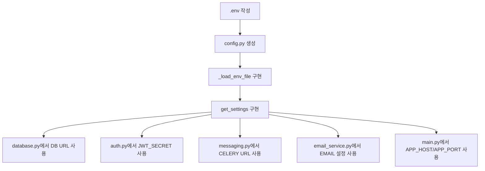

# 환경설정 구현 흐름

## 왜 먼저 구현했는가

DB, JWT, Gmail SMTP, Celery는 전부 환경마다 값이 다릅니다. 이 값들을 코드에 직접 쓰면 DB 비밀번호나 Gmail 앱 비밀번호가 코드에 박히고, 설정을 바꿀 때마다 코드를 수정해야 합니다. 그래서 가장 먼저 `.env` 기반 설정 구조를 만들었습니다.

## 구현한 파일 순서

```text
.env
-> config.py
-> database.py
-> common/auth.py
-> common/messaging.py
-> user/application/email_service.py
-> main.py
```

## 코드 구현 흐름



## 실제 호출 흐름

```text
서버 import
-> config.get_settings()
-> .env 파일 읽음
-> os.environ에 값 등록
-> Settings 객체 생성
-> 각 모듈에서 필요한 설정 사용
```

## 핵심 코드

```python
def get_settings() -> Settings:
    _load_env_file()

    return Settings(
        database_username=_get_required_env("DATABASE_USERNAME"),
        jwt_secret=_get_required_env("JWT_SECRET"),
        email_sender=_get_required_env("EMAIL_SENDER"),
        celery_broker_url=_get_required_env("CELERY_BROKER_URL"),
    )
```

## 구현하면서 생긴 문제와 해결

PowerShell로 `.env`를 저장하면서 BOM이 붙었습니다. 그러면 첫 번째 환경변수 이름이 정상적으로 읽히지 않습니다. 그래서 `.env`를 `utf-8-sig`로 읽게 했습니다.

```python
env_path.read_text(encoding="utf-8-sig")
```

Gmail 앱 비밀번호는 사람이 보기 좋게 공백이 들어갈 수 있습니다. SMTP 로그인에는 공백 없는 16자리 값이 필요해서 공백을 제거했습니다.

```python
email_password=_get_required_env("EMAIL_PASSWORD").replace(" ", "")
```