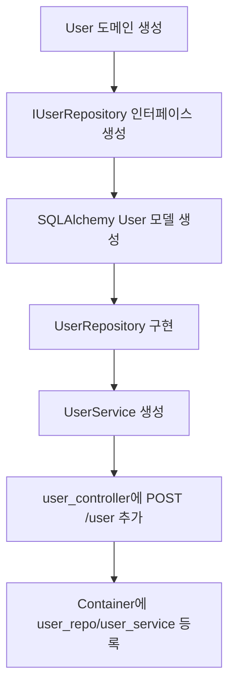
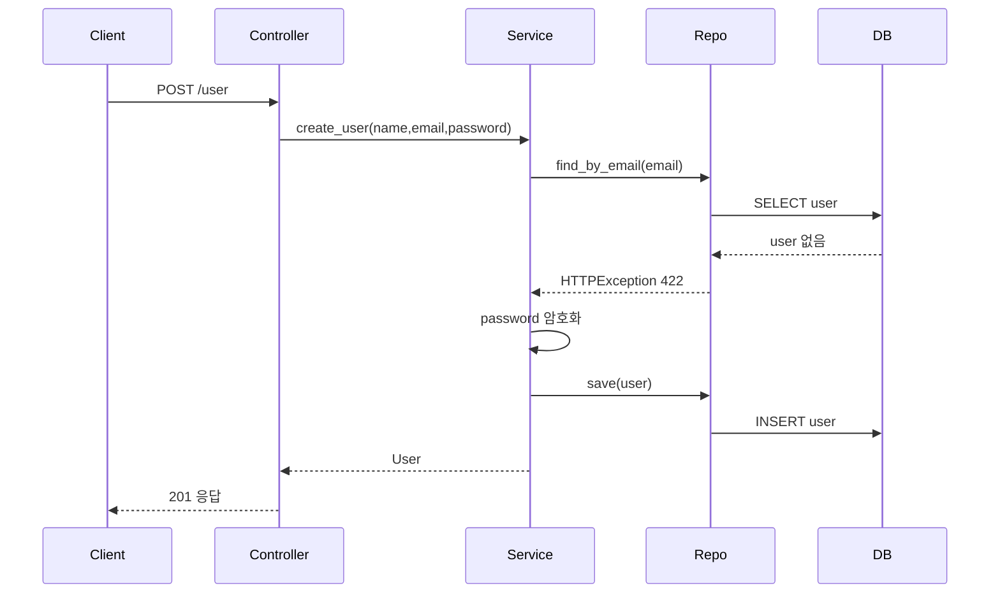

# 사용자와 회원가입 구현 흐름

## 왜 구현했는가

TIL 앱은 사용자별로 글을 관리해야 합니다. 그러려면 먼저 사용자를 만들고 DB에 저장하는 기능이 필요합니다. 로그인과 TIL 기능은 회원가입 이후에 붙일 수 있습니다.

## 구현한 파일 순서

```text
user/domain/user.py
-> user/domain/repository/user_repo.py
-> user/infra/db_models/user.py
-> user/infra/repository/user_repo.py
-> utils/crypto.py 확인
-> user/application/user_service.py
-> user/interface/controllers/user_controller.py
-> containers.py 연결
```

## 구현 흐름 그림



## 요청 처리 코드 흐름



## 핵심 구현 이유

### 1. Domain을 먼저 만든 이유

```python
@dataclass
class User:
    id: str
    name: str
    email: str
    password: str
```

서비스와 컨트롤러가 SQLAlchemy 모델에 직접 의존하지 않게 하려고 도메인 객체를 먼저 만들었습니다.

### 2. Repository interface를 만든 이유

```python
class IUserRepository(metaclass=ABCMeta):
    def save(self, user: User): ...
    def find_by_email(self, email: str) -> User: ...
```

Service는 “저장한다, 찾는다”만 알면 됩니다. SQLAlchemy로 저장하는지, 다른 DB로 저장하는지는 infra 계층이 알면 됩니다.

### 3. Service에서 중복 검사를 한 이유

```python
try:
    _user = self.user_repo.find_by_email(email)
except HTTPException as e:
    if e.status_code != 422:
        raise e

if _user:
    raise HTTPException(status_code=422)
```

회원가입은 같은 이메일을 두 번 저장하면 안 됩니다. 그래서 DB 저장 전에 이메일 중복을 확인합니다.

### 4. 비밀번호 암호화를 Service에 둔 이유

```python
password=self.crypto.encrypt(password)
```

비밀번호 암호화는 회원가입 비즈니스 규칙입니다. Controller가 아니라 Service에서 처리합니다.

## 최종 API

```text
POST /user
GET /user
PUT /user/{user_id}
DELETE /user/{user_id}
```