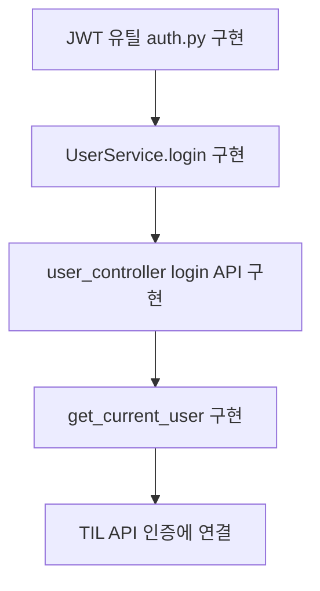
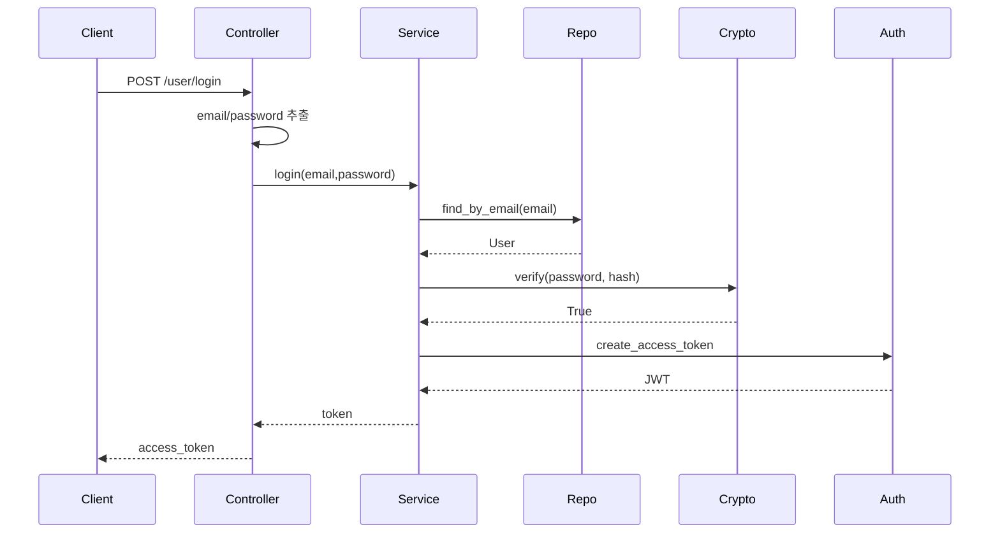
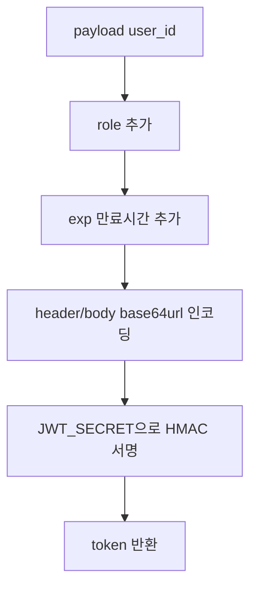
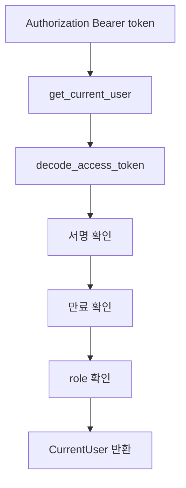

# 로그인과 JWT 구현 흐름

## 왜 구현했는가

TIL 노트는 로그인한 사용자만 작성해야 합니다. 그래서 회원가입 다음 단계로 로그인과 JWT 인증을 구현했습니다.

## 구현한 파일 순서

```text
common/auth.py
-> user/application/user_service.py login 추가
-> user/interface/controllers/user_controller.py POST /user/login 추가
-> note_controller에서 get_current_user 사용
-> middlewares.py에서 decode_access_token 재사용
```

## 구현 흐름 그림



## 로그인 요청 코드 흐름



## JWT 생성 코드 흐름



## 보호 API 인증 코드 흐름



## 핵심 구현 이유

### 1. JSON과 form을 둘 다 받게 한 이유

원본 GitHub는 `OAuth2PasswordRequestForm`을 씁니다. 로컬 환경에는 `python-multipart`가 없어서 앱 import가 깨졌습니다. 그래서 JSON과 form body를 직접 파싱하게 했습니다.

```python
if "application/json" in content_type:
    body = await request.json()
else:
    form = parse_qs((await request.body()).decode("utf-8"))
```

### 2. role을 token에 넣은 이유

```python
payload={"user_id": user.id}, role=Role.USER
```

나중에 일반 유저와 관리자 권한을 나눌 수 있게 하기 위해 role을 토큰에 넣었습니다.

### 3. get_current_user를 dependency로 만든 이유

TIL API마다 토큰 검증 코드를 반복하지 않기 위해 FastAPI dependency로 만들었습니다.

```python
current_user: Annotated[CurrentUser, Depends(get_current_user)]
```

## 실패 케이스

```text
email/password 없음 -> 400
유저 없음 -> 422
비밀번호 틀림 -> 401
토큰 잘못됨 -> 401
role이 USER 아님 -> 403
```