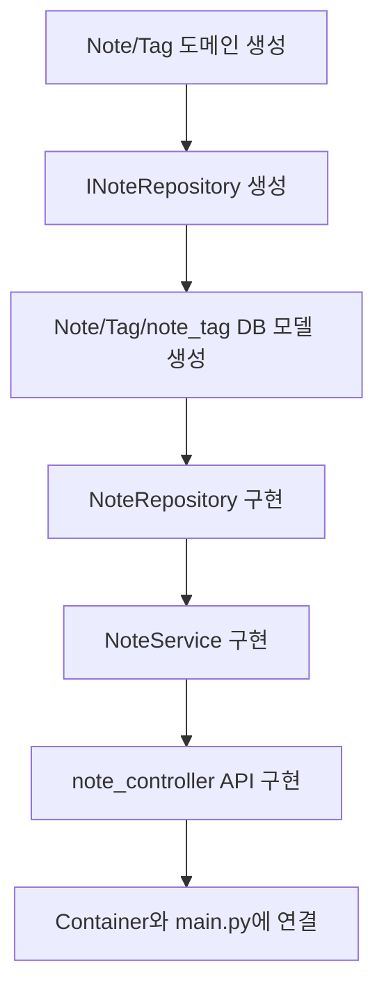
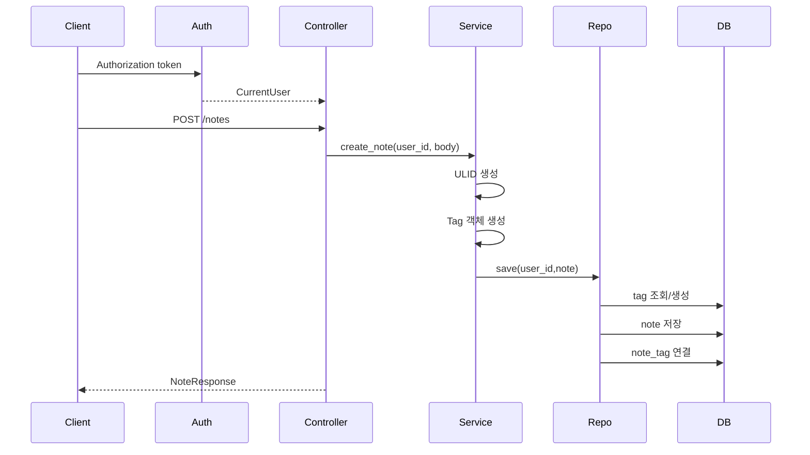
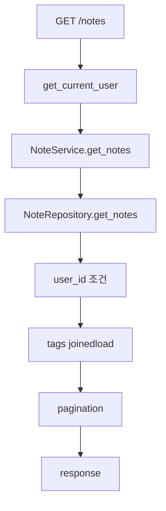
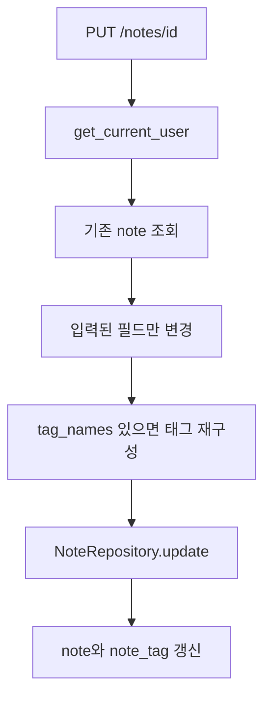
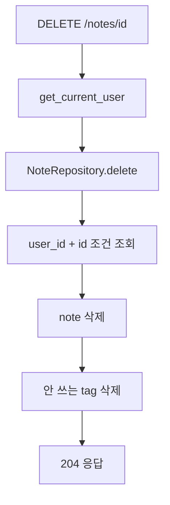
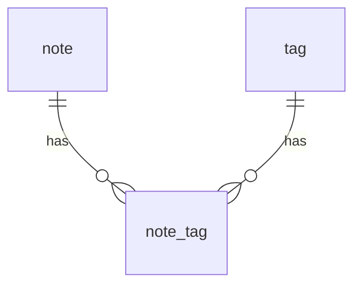

# TIL CRUD 구현 흐름

## 왜 구현했는가

프로젝트 이름이 TIL App이므로 핵심 기능은 사용자가 오늘 배운 내용을 기록하는 것입니다. 유저와 로그인 기능이 준비된 뒤, 로그인한 사용자 기준으로 TIL 노트를 CRUD할 수 있게 구현했습니다.

## 구현한 파일 순서

```text
note/domain/note.py
-> note/domain/repository/note_repo.py
-> note/infra/db_models/note.py
-> note/infra/repository/note_repo.py
-> note/application/note_service.py
-> note/interface/controllers/note_controller.py
-> containers.py에 note_repo/note_service 등록
-> main.py에 note router 등록
```

## 구현 흐름 그림



## 작성 구현 흐름



## 조회 구현 흐름



## 수정 구현 흐름



## 삭제 구현 흐름



## 핵심 구현 이유

### 1. 모든 Repository 쿼리에 user_id를 넣은 이유

```python
.filter(NoteModel.user_id == user_id, NoteModel.id == id)
```

노트 ID를 알아도 남의 노트를 조회, 수정, 삭제하지 못하게 하기 위해서입니다.

### 2. tag를 별도 테이블로 만든 이유

한 노트에 여러 태그가 붙고, 같은 태그가 여러 노트에 붙을 수 있습니다. 그래서 `note`, `tag`, `note_tag` 세 테이블로 나눴습니다.



### 3. Service에서 도메인 객체를 만드는 이유

```python
note = Note(
    id=self.ulid.generate(),
    user_id=user_id,
    title=title,
    content=content,
    memo_date=memo_date,
    tags=tags,
)
```

ID 생성과 생성 시간, 태그 객체 구성은 비즈니스 로직입니다. DB 저장소가 아니라 Service에서 처리합니다.

## 최종 API

```text
POST   /notes
GET    /notes
GET    /notes/{id}
PUT    /notes/{id}
DELETE /notes/{id}
GET    /notes/tags/{tag_name}/notes
```