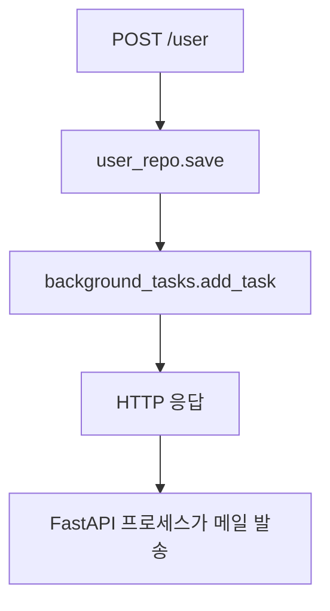
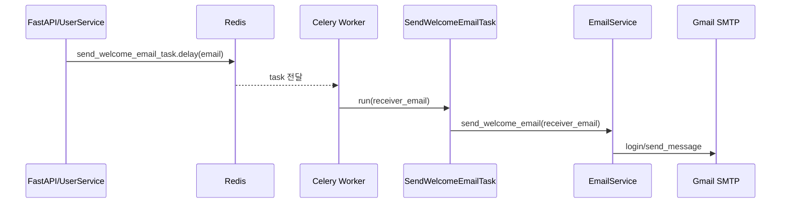

# 메일과 Celery 구현 흐름

## 왜 구현했는가

회원가입 후 환영 메일을 보내야 했습니다. 처음에는 FastAPI `BackgroundTasks`로 처리했고, 이후 GitHub 저장소에 있는 Celery 설정을 참고해서 Redis + Celery worker 방식으로 바꿨습니다.

## 구현한 파일 순서

```text
user/application/email_service.py
-> UserService에서 BackgroundTasks 연결
-> common/messaging.py 생성
-> user/application/send_welcome_email_task.py 생성
-> pyproject.toml에 celery[redis] 추가
-> .env에 CELERY_BROKER_URL/CELERY_BACKEND_URL 추가
-> UserService에서 .delay() 호출로 변경
-> containers.py에 send_welcome_email_task 주입
```

## BackgroundTasks 초기 구현 흐름



이 방식은 간단하지만 API 서버가 메일 발송까지 책임집니다. 외부 SMTP가 느리거나 실패하면 서버 프로세스에 부담이 갑니다.

## Celery 최종 구현 흐름



## common/messaging.py 구현 이유

```python
celery = Celery(
    "til-app",
    broker=settings.celery_broker_url,
    backend=settings.celery_backend_url,
)

send_welcome_email_task = celery.register_task(SendWelcomeEmailTask())
```

FastAPI와 Celery worker가 같은 Celery app과 같은 task 이름을 알아야 합니다. 그래서 task 등록을 공통 모듈에 뒀습니다.

## SendWelcomeEmailTask 구현 이유

```python
class SendWelcomeEmailTask(Task):
    name = "send_welcome_email_task"

    def run(self, receiver_email: str):
        EmailService().send_welcome_email(receiver_email)
```

worker가 실제로 실행할 작업 단위입니다. API 서버는 이 함수를 직접 실행하지 않고 Redis 큐에 작업만 넣습니다.

## UserService 변경 이유

```python
self.user_repo.save(user)
self.send_welcome_email_task.delay(user.email)
```

유저 저장이 성공한 뒤에만 메일 작업을 큐에 넣습니다. DB 저장 전에 메일을 보내면 실제 가입되지 않은 유저에게 메일이 갈 수 있습니다.

## 실행 흐름

```text
1. Redis 실행
2. Celery worker 실행
3. FastAPI 실행
4. 회원가입 요청
5. Redis에 task 저장
6. worker가 task 수신
7. Gmail SMTP로 메일 발송
```

## 실행 명령

```bash
docker start til-redis
.venv/Scripts/celery.exe -A common.messaging.celery worker --loglevel=info --pool=solo
.venv/Scripts/uvicorn.exe main:app --reload
```

## 성공 확인

```text
Task send_welcome_email_task[...] received
Task send_welcome_email_task[...] succeeded
```