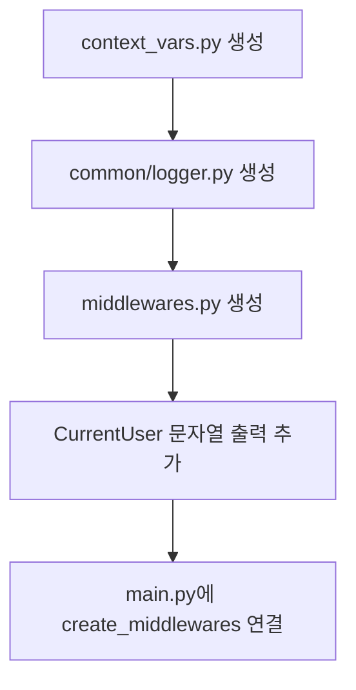
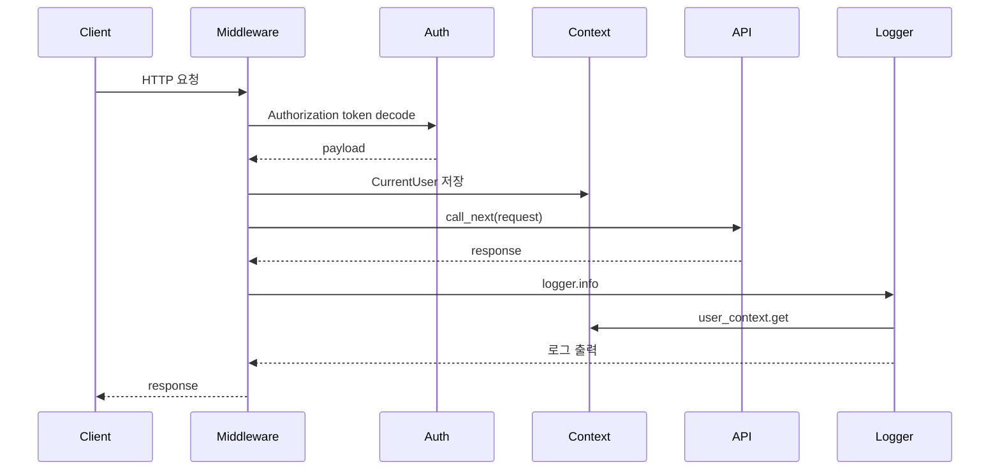

# 로깅 구현 흐름

## 왜 구현했는가

기능이 늘어나면 어떤 요청이 들어왔고, 누가 호출했고, 응답이 몇 ms 걸렸는지 확인해야 합니다. 그래서 GitHub 저장소의 로깅 구조를 참고해서 요청 로깅 미들웨어를 붙였습니다.

## 구현한 파일 순서

```text
context_vars.py
-> common/logger.py
-> middlewares.py
-> common/auth.py에 CurrentUser.__str__ 추가
-> main.py에 create_middlewares(app) 연결
```

## 구현 흐름 그림



## 요청 로깅 실행 흐름



## context_vars.py를 만든 이유

```python
user_context = ContextVar("current_user", default=None)
```

요청마다 현재 유저를 저장하려고 만들었습니다. 함수마다 user를 인자로 넘기지 않아도 logger가 현재 요청의 유저를 알 수 있습니다.

## common/logger.py를 만든 이유

```python
class ContextFilter(logging.Filter):
    def filter(self, record):
        user = user_context.get()
        record.user = str(user) if user else "Anonymous"
        return True
```

로그 레코드에 `user` 필드를 자동으로 붙이기 위해 만들었습니다.

## middlewares.py를 만든 이유

```python
@app.middleware("http")
async def logging_middleware(request, call_next):
    ...
```

모든 요청이 Controller에 들어가기 전에 실행되게 하기 위해 FastAPI middleware를 사용했습니다.

## main.py에 연결한 이유

```python
create_middlewares(app)
```

미들웨어 함수만 만들어서는 실행되지 않습니다. FastAPI app에 등록해야 모든 요청을 감쌀 수 있습니다.

## 실제 로그

```text
2026-05-19 20:20:54,318 til-app INFO: user: Anonymous: GET / -> 200 2.74ms
2026-05-19 20:21:07,401 til-app INFO: user: user-1(USER): GET / -> 200 4.14ms
```

## 구현 판단

토큰이 잘못된 경우 로깅 미들웨어는 요청을 막지 않고 Anonymous로 둡니다. 실제 인증 차단은 각 API의 `get_current_user` dependency가 담당합니다. 이렇게 나눈 이유는 로깅은 관찰 기능이고, 인증은 비즈니스/API 보호 기능이기 때문입니다.