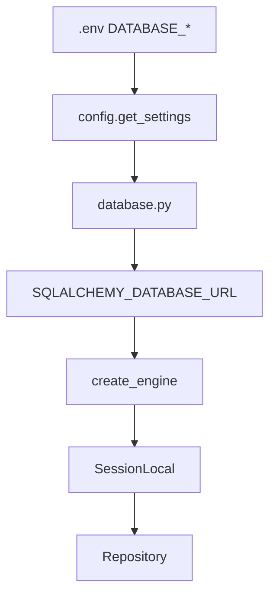
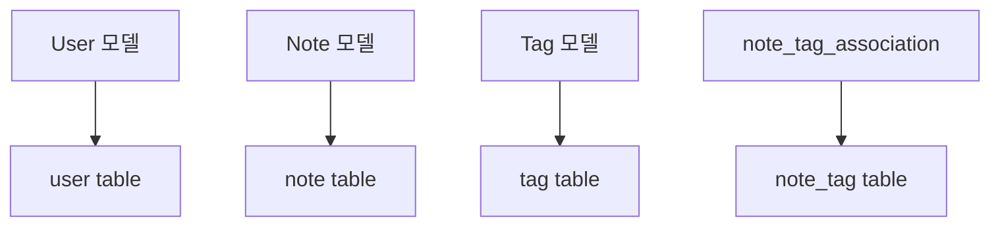
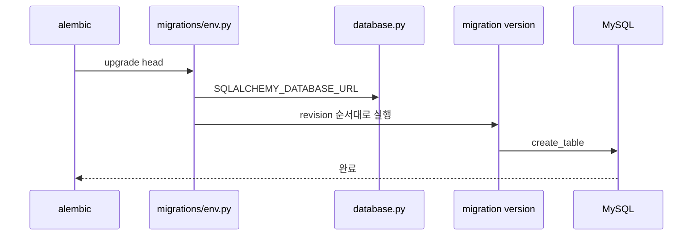
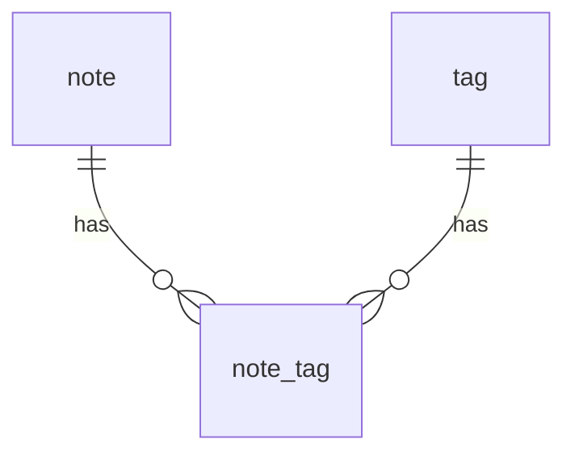

# DB와 마이그레이션 구현 흐름

## 왜 구현했는가

SQLAlchemy 모델을 코드에 만든다고 실제 MySQL 테이블이 자동으로 생기지는 않습니다. API가 DB를 사용하려면 실제 테이블이 있어야 하므로 Alembic 마이그레이션을 추가했습니다.

## 구현한 파일 순서

```text
database.py
-> user/infra/db_models/user.py
-> note/infra/db_models/note.py
-> database_model.py
-> migrations/env.py 확인
-> migrations/versions/5081832f5d2c_add_user_table.py
-> migrations/versions/8b2f6c1d4e90_add_note_tables.py
```

## DB 연결 구현 흐름



## 모델 구현 흐름



## Alembic 실행 흐름



## database_model.py가 필요한 이유

```python
import note.infra.db_models.note
import user.infra.db_models.user
```

Alembic이 SQLAlchemy metadata에서 모델들을 인식하려면 모델 import가 필요합니다.

## note/tag 관계를 이렇게 만든 이유



한 노트에 여러 태그가 붙고, 같은 태그가 여러 노트에 재사용될 수 있으므로 다대다 구조가 필요했습니다.

## 실행 명령

```bash
.venv/Scripts/alembic.exe upgrade head
```

## 구현 판단

Repository는 테이블이 있다고 가정하고 query를 실행합니다. 그래서 모델 구현 이후 반드시 마이그레이션을 추가하고 실행해야 합니다.