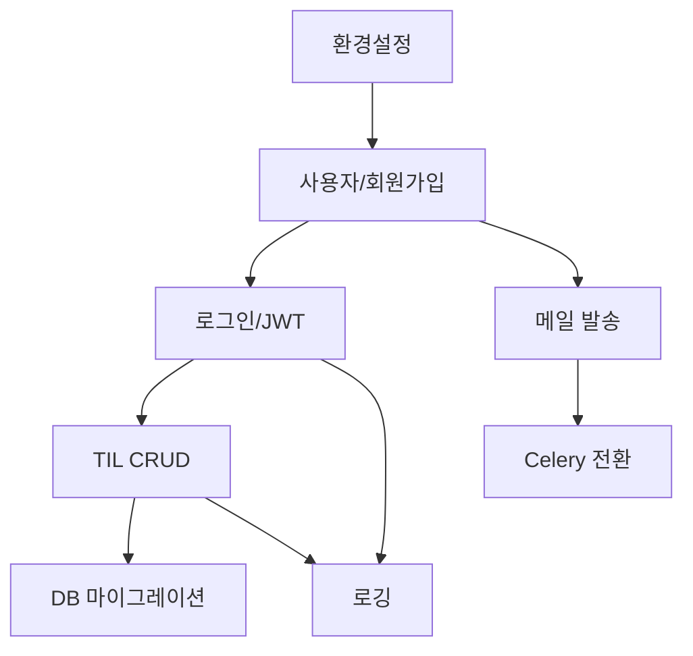

# 기능별 구현 흐름

이 디렉터리는 프로젝트 구현 과정을 기능별로 나눠 설명합니다. 각 문서는 “왜 이 기능을 만들었는가 -> 어떤 파일을 어떤 순서로 만들었는가 -> 코드가 실제로 어떻게 호출되는가 -> 구현하면서 주의할 점” 순서로 정리했습니다.

## 문서 목록

```text
01_환경설정_구현흐름.md
02_사용자_회원가입_구현흐름.md
03_로그인_JWT_구현흐름.md
04_TIL_CRUD_구현흐름.md
05_메일_Celery_구현흐름.md
06_로깅_구현흐름.md
07_DB_마이그레이션_구현흐름.md
```

## 전체 구현 순서

